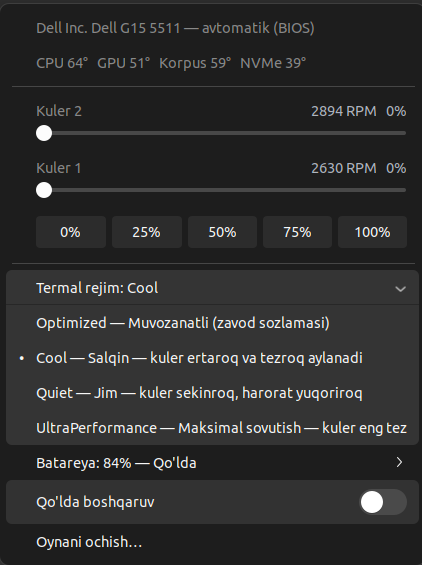

# dell-g15-fanctrl

**Fan control, thermal modes and battery charge limits for Dell G15 laptops on Linux** —
a small root daemon, a `fanctrl` command, a PyQt5 window and a GNOME top-bar indicator.

[](LICENSE)


On Dell G15 laptops the usual Linux fan tools (`pwmconfig`, `fancontrol`, i8kutils,
`dell_smm` pwm files) do not work: since ~2021 Dell firmware ignores the old SMM fan
commands, so writes to `/sys/class/hwmon/*/pwm*` succeed but change nothing.
`fanctrl` uses the same **AWCC (Alienware Command Center) WMAX** ACPI interface the
Windows app uses, so you can actually spin the fans up — plus switch BIOS thermal
modes and cap battery charging, all from Linux.

> Tested on **Dell G15 5511** (Ubuntu 22.04, kernel 6.8, GNOME 42).
> Other G15 / Alienware models with the same WMAX interface will likely work —
> please [report your model](#reporting-your-model), whether it works or not.

## Features

- **Fan boost 0–100% per fan** via AWCC WMAX (`acpi_call`) — measured up to ~4850 / ~5100 RPM
- **BIOS thermal modes** — Quiet / Optimized / Cool / UltraPerformance (`dell-wmi-sysman`)
- **Battery charge limit** — Adaptive / Standard / Express / PrimAcUse / Custom start–stop thresholds
- **Safety governor** in the daemon — overheat protection keeps working even if the GUI is closed
- **Three front ends** — `fanctrl` CLI, `fanctrl-gui` window with live graphs, GNOME top-bar indicator (`66° · 2.6k`)
- **Generic hwmon pwm fallback** for machines where pwm writes really work, with step calibration
- Unprivileged clients — only the daemon runs as root; clients talk to it over a group-restricted unix socket
- No dependencies beyond Python 3.9+ (PyQt5 only for the window)
- Translatable — English by default, Uzbek included, [add your language](#adding-a-language) with one JSON file

<p align="center">
  
  <br><sub>GNOME top-bar menu — shown here with the Uzbek translation</sub>
</p>

## Install

```bash
sudo apt install acpi-call-dkms python3-pyqt5   # acpi_call: fan boost, PyQt5: window (optional)
git clone https://github.com/nurbekliv/dell-g15-fanctrl.git
cd dell-g15-fanctrl
sudo ./install.sh
```

`install.sh` puts everything in place and starts the daemon:

| What | Where |
|---|---|
| Python package | `/opt/fanctrl/fanctrl/` |
| Commands | `/usr/local/bin/fanctrl`, `/usr/local/bin/fanctrl-gui` |
| Config | `/etc/fanctrld.conf` (socket group = your primary group) |
| systemd service | `/etc/systemd/system/fanctrld.service` (enabled and started) |
| `acpi_call` autoload | `/etc/modules-load.d/acpi_call.conf` |
| Menu entry | `/usr/share/applications/fanctrl.desktop` ("Fan Control") |

GNOME top-bar indicator (no sudo; log out and back in afterwards on Wayland):

```bash
./install-extension.sh
```

Global hotkey to open the window (default <kbd>Super</kbd>+<kbd>Shift</kbd>+<kbd>F</kbd>):

```bash
./setup-hotkey.sh                 # or: ./setup-hotkey.sh '<Super>F9'
```

Uninstall: `sudo ./uninstall.sh` (add `--purge` to also remove `/etc/fanctrld.conf`).

## Usage

```bash
fanctrl status                  # temperatures, fan RPM, mode
fanctrl status -a               # include every sensor
fanctrl watch -n 1              # live view, Ctrl+C to quit

fanctrl set all 70%             # both fans to 70% boost (switches to manual)
fanctrl set 1 max               # fan 1 to 100%
fanctrl set 2 0                 # fan 2 back to BIOS control
fanctrl auto                    # everything back to BIOS control

fanctrl profile                 # list BIOS thermal modes
fanctrl profile UltraPerformance

fanctrl battery                 # charge, health, current charge mode
fanctrl battery PrimAcUse       # "always plugged in" mode
fanctrl battery custom 50 60    # charge below 50%, stop at 60%

fanctrl calibrate               # hwmon pwm method only: detect pwm steps
fanctrl config                  # show daemon settings
```

`fanctrl-gui` (or **Fan Control** in the app menu) shows the same controls with
per-fan sliders and a ~3 minute temperature / RPM graph. The GNOME indicator puts
the hottest sensor and fan speed in the top bar; its menu has sliders, presets,
thermal mode, battery info and an *Open window…* item. It polls every 5 s while
closed and every 1 s while open, fully asynchronously.

## How it works

```
 fanctrl (CLI) ─┐
 fanctrl-gui ───┼── /run/fanctrld.sock ──> fanctrld (root, systemd)
 GNOME panel ───┘    JSON lines,              ├─ hwmon sensors, nvidia-smi
                     group-restricted         ├─ AWCC WMAX boost via acpi_call
                                              ├─ BIOS thermal mode / battery via dell-wmi-sysman
                                              └─ safety governor
```

At start-up the daemon picks a control method:

| Method | What it does | Chosen when |
|---|---|---|
| **AWCC boost** | Adds 0–100% boost on top of the BIOS fan curve (`\_SB.AMWW.WMAX`) | Dell / Alienware G-series and `acpi_call` is loaded |
| **hwmon pwm** | Classic `pwm1`/`pwm2` writes (0–255) | a pwm write is verified to actually take effect |
| none | monitoring only | neither works |

Measured on a G15 5511:

| Boost | Fan 1 | Fan 2 |
|---|---|---|
| 0% (BIOS) | 1550 RPM | 1588 RPM |
| 45% | 2507 RPM | 2476 RPM |
| 60% | 3100 RPM | 3193 RPM |
| **100%** | **4854 RPM** | **5119 RPM** |

**Why boost is safe:** it is added *on top of* the BIOS curve — it can only make the
fans faster, never slower. A wrong setting cannot cause overheating, so in this mode the
daemon never takes control away from you.

**Why plain pwm does not work on the G15:** writing `pwm1` succeeds, but the firmware
keeps it at 128:

```
requested=255 | immediately=128 | 0.3s=128 | 3s=128
requested=0   | immediately=128 | 0.3s=128 | 3s=128
```

There is no `pwm1_enable` — the `dell_smm` driver detected that the BIOS does not allow
manual fan mode over SMM. That is why the daemon runs a short **pwm self-test** at
start-up and never offers a fake "manual" mode when writes are ignored.

### Safety governor

With **AWCC boost** (only increases cooling):

| Threshold | Default | Action |
|---|---|---|
| `warn_temp` | 85 °C | boost temporarily raised to 100% |
| `warn_temp - warn_hysteresis` | 79 °C | your setting is restored |
| sensors unreadable | — | boost 100% (safest state) |

With **hwmon pwm** (a manual setting *can* slow fans down, so it is stricter):

| Threshold | Default | Action |
|---|---|---|
| `warn_temp` | 85 °C | manual setting suspended, fans to 100% |
| `warn_temp - warn_hysteresis` | 79 °C | manual setting restored |
| `critical_temp` | 93 °C | manual mode cancelled, control returned to BIOS, manual mode locked for `lockout_seconds` (120 s) |
| sensors unreadable | — | back to automatic |

In both modes: three consecutive write errors → back to automatic; when the daemon stops
(`systemctl stop fanctrld`, shutdown) the fans are handed back to the BIOS (boost 0).
Only CPU, GPU and SMM sensors drive the governor; NVMe and Wi-Fi are shown but have their
own protection.

### BIOS thermal modes

Independent from boost (both can be combined). Changed through `dell-wmi-sysman`
(works when no BIOS admin password is set) and stored in the BIOS, so it survives
reboots. Measured at a similar load (CPU ≈ 60–64 °C):

| Mode | Fan 1 | Fan 2 |
|---|---|---|
| Quiet | 2028 RPM | 2214 RPM |
| Optimized (factory) | 2072 RPM | 2287 RPM |
| Cool | 2185 RPM | 2493 RPM |
| UltraPerformance | 2509 RPM | 2821 RPM |

### Battery charge limit

Keeping a laptop plugged in does not wear the battery — sitting at **100%** does: a
li-ion cell at full charge is under high voltage and slowly loses capacity. Holding it at
60–80% avoids that. `fanctrl` sets the BIOS options `PrimaryBattChargeCfg`,
`CustomChargeStart` and `CustomChargeStop`; the setting lives in firmware, so it also
applies when Linux is off or you boot Windows.

| Mode | Meaning |
|---|---|
| `Adaptive` | BIOS picks based on your usage (factory default) |
| `Standard` | always charge to 100% |
| `Express` | fastest charging, most wear |
| `PrimAcUse` | always plugged in: holds around ~50%, least wear |
| `Custom` | charge when below `start`, stop at `stop` (start 50–95%, stop 55–100%, gap ≥ 5%) |

**Health** = `charge_full / charge_full_design`. After setting a lower limit the battery
slowly drains down to it — that is expected.

## Configuration

Edit `/etc/fanctrld.conf`, then `sudo systemctl restart fanctrld`.

| Key | Meaning |
|---|---|
| `socket_group` | group allowed to control the fans |
| `poll_interval` | sensor read interval, seconds (default 2) |
| `fan_order` | display order of fans, e.g. `2,1` (display only) |
| `warn_temp`, `warn_hysteresis`, `critical_temp`, `lockout_seconds` | governor thresholds (see above) |
| `min_manual_pwm` | lowest pwm allowed in manual mode (e.g. `60` = fans never stop) |
| `restore_on_start` | restore the last manual setting when the daemon restarts |

## Troubleshooting

```bash
systemctl status fanctrld
journalctl -u fanctrld -f          # daemon log
ls -l /run/fanctrld.sock           # socket and its group
sensors                            # compare with lm-sensors
journalctl -f -o cat /usr/bin/gnome-shell   # GNOME indicator errors
```

- **socket not found** — the daemon is not running: `sudo systemctl start fanctrld`
- **permission denied** — `socket_group` in `/etc/fanctrld.conf` is not one of your groups
- **no pwm control found / monitoring only** — `acpi_call` is not loaded
  (`sudo modprobe acpi_call`) and hwmon pwm writes are ignored by the firmware
- **thermal mode / battery options missing** — the `dell-wmi-sysman` driver is not loaded,
  or a BIOS admin password is set

## Adding a language

All text in the code is English; a translation is one JSON file that maps each English
string to your language. Missing entries simply fall back to English, so partial
translations are fine.

1. Generate the template (here for German, `de`):

   ```bash
   python3 tools/i18n_check.py --init de
   ```

   This creates two files with every string and an empty value:
   - `fanctrl/locales/de.json` — CLI, window and daemon messages
   - `gnome-extension/fanctrl@nurbekliv.github.io/locales/de.json` — GNOME indicator

2. Fill in the values. Keep `{placeholders}` exactly as they are:

   ```json
   {
     "Fan {n}": "Lüfter {n}",
     "Manual control": "Manuelle Steuerung"
   }
   ```

3. Check it and try it:

   ```bash
   python3 tools/i18n_check.py                    # translated / missing / unused per language
   FANCTRL_LANG=de PYTHONPATH=. python3 -m fanctrl.cli status
   ```

   The language is picked from `FANCTRL_LANG`, then `LANGUAGE` / `LC_ALL` / `LC_MESSAGES` /
   `LANG` (`de_DE.UTF-8` → `de_DE.json`, then `de.json`). Daemon messages follow the
   system locale; to force one, run `sudo systemctl edit fanctrld` and add
   `Environment=FANCTRL_LANG=de`.

4. Open a pull request. `fanctrl/locales/uz.json` (Uzbek) is a complete example.

## Reporting your model

Please open an issue with:

```bash
cat /sys/class/dmi/id/product_name /sys/class/dmi/id/bios_version
uname -r
fanctrl status -a
journalctl -u fanctrld -b --no-pager | head -50
```

and whether `fanctrl set all 100%` audibly spins the fans up. Working models will be
listed here.

## Project layout

```
fanctrl/
  daemon.py     root daemon: loop, safety governor, unix socket server
  hwmon.py      sysfs layer: fans, temperature sensors, nvidia-smi
  awcc.py       AWCC WMAX boost via acpi_call
  thermal.py    BIOS thermal modes (dell-wmi-sysman)
  battery.py    battery health and charge modes (dell-wmi-sysman)
  client.py     socket client        protocol.py   JSON-lines protocol
  config.py     /etc/fanctrld.conf   i18n.py       translations
  cli.py        fanctrl command      gui.py        PyQt5 window
  locales/      translations (<lang>.json)
gnome-extension/fanctrl@nurbekliv.github.io/   GNOME 42–44 top-bar indicator
systemd/fanctrld.service   share/fanctrl.desktop
install.sh / uninstall.sh  install-extension.sh  setup-hotkey.sh
tools/i18n_check.py        translation template / coverage check
```

The command is `fanctrl`, not `fanctl`: on Ubuntu `fanctl` already belongs to the
`ubuntu-fan` package (Fan Networking for LXD/Docker).

## Roadmap

- GNOME 45+ version of the indicator (ESM extension API) — help welcome
- More confirmed models

## Disclaimer

This tool calls vendor ACPI methods and changes BIOS settings. It was written carefully
and tested on the hardware above, but it is not affiliated with or endorsed by Dell, and
you use it at your own risk.

## License

[MIT](LICENSE) © Nurbek Amrulloyev · Oʻzbekcha: [README.uz.md](README.uz.md)
